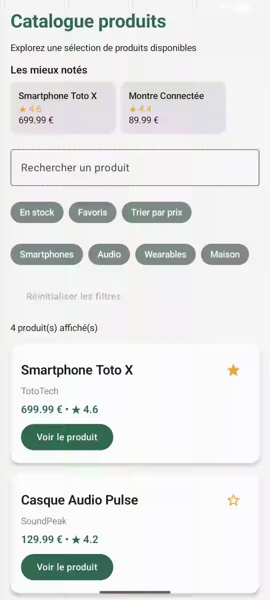
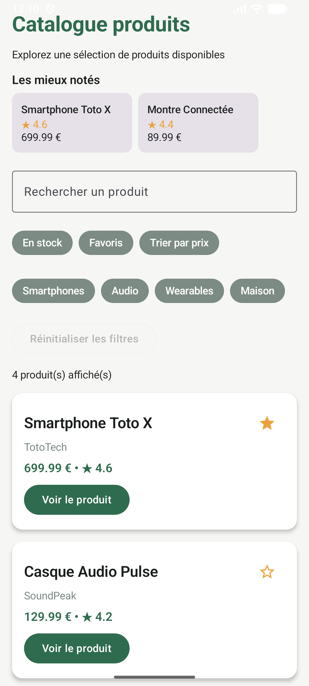
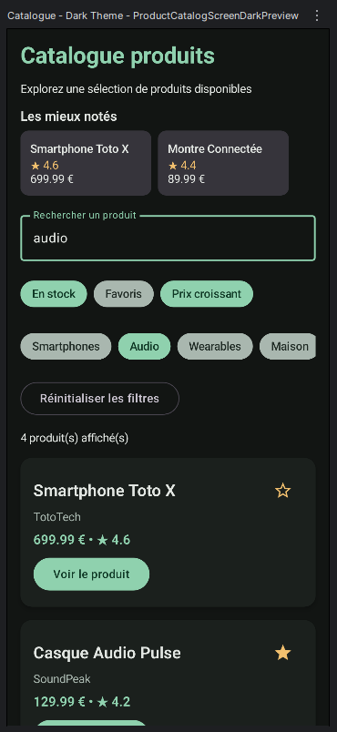
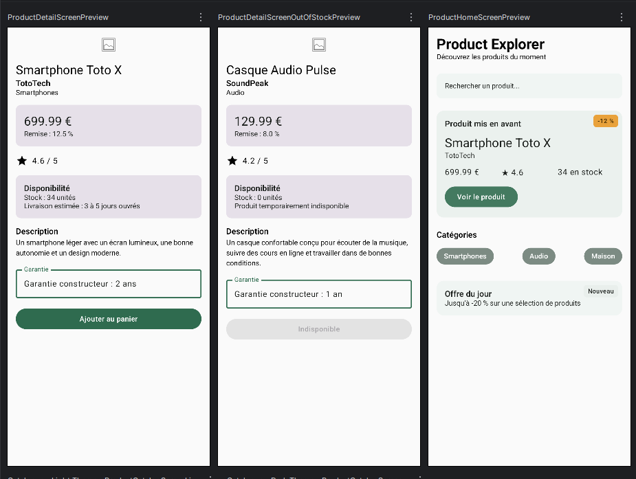

# Product Explorer

Projet fil rouge du cours Android avec Jetpack Compose. L'application affiche un catalogue de produits locaux, avec recherche, filtres, tri et favoris.

## Contenu par TP

| TP | Notion | Réalisé | Autonomie |
|---|---|---|---|
| TP4 | Composants de base | Écran de détail produit | Bouton « Ajouter au panier » désactivé en rupture de stock |
| TP5 | Layouts | Écran d'accueil | Badge de remise sur le produit mis en avant |
| TP6 | Listes (`LazyColumn`, `LazyRow`) | Catalogue de produits | `LazyRow` « Les mieux notés » |
| TP7 | Material Design 3 | Thème, couleurs, formes | Palette vert sauge et formes plus modernes |
| TP8 | État local (`remember`, `rememberSaveable`) | Recherche, filtre stock, favoris | – |
| TP9 | State Hoisting | Écran stateless + container | Filtre par catégorie |
| TP10 | ViewModel | État déplacé dans `ProductCatalogViewModel` | Bouton « Réinitialiser les filtres » |
| TP11 | StateFlow | État regroupé dans `ProductCatalogUiState`, exposé en `StateFlow` | Filtre favoris, tri par prix, filtres en pastilles, étoile favori |

## Organisation de l'état

- `ProductCatalogUiState` : l'état complet de l'écran
- `ProductCatalogViewModel` : seul à modifier l'état, avec `update` et `copy`
- `ProductCatalogContainer` : relie le ViewModel à l'écran
- `ProductCatalogScreen` : affiche l'état, sans le stocker
- `ProductListItem`, `CategoryChip`, `CategoryRow`, `TopRatedProductCard` : composants réutilisables

## Organisation Git

Une branche par TP (`tp4` à `tp11`), fusionnée dans `dev`, puis dans `main`. Les autonomies des TP4 à TP7 ont été ajoutées ensuite sur la branche `feat/extra-features`.

## Démo

*Cliquez sur la démo pour la lancer si elle ne démarre pas automatiquement.*

## Captures d'écran

